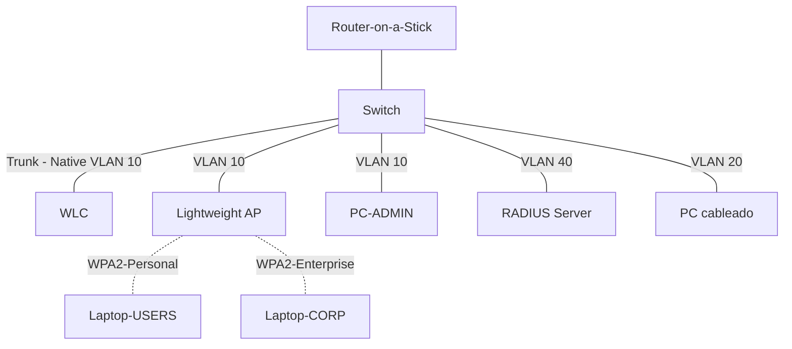

# 📡 Enterprise Wireless Network

**Cisco WLC | WPA2 | RADIUS | 802.1Q Troubleshooting**


## 🎯 Descripción

Implementación de una infraestructura inalámbrica empresarial
centralizada mediante Cisco WLC y Lightweight AP, integrando
segmentación VLAN, DHCP y autenticación RADIUS.

Durante las pruebas se detectó un comportamiento inesperado
en el etiquetado 802.1Q, que dio lugar a un proceso de
troubleshooting basado en evidencia técnica.

## 🌐 Topología



## 📋 Direccionamiento

| VLAN | Función | Subred | Gateway |
|---|---|---|---|
| 10 | Management | 192.168.10.0/24 | 192.168.10.1 |
| 20 | WIFI-USERS | 192.168.20.0/24 | 192.168.20.1 |
| 30 | WIFI-CORP | 192.168.30.0/24 | 192.168.30.1 |
| 40 | AAA Services | 192.168.40.0/24 | 192.168.40.1 |

- WLC Management: `192.168.10.10`
- RADIUS Server: `192.168.40.10`
- RADIUS Authentication: UDP 1812

## 🔐 Seguridad Wireless

| Configuración | WPA2-Personal | WPA2-Enterprise |
|---|:---:|:---:|
| SSID | WIFI-USERS | WIFI-CORP |
| VLAN | 20 | 30 |
| WPA2 | ✅ | ✅ |
| AES | ✅ | ✅ |
| TKIP | ⬜ | ⬜ |
| PSK | ✅ | ⬜ |
| 802.1X | ⬜ | ✅ |
| RADIUS | ⬜ | ✅ |

La autenticación Enterprise se verificó utilizando
credenciales correctas e incorrectas, comprobando
el rechazo y la recuperación de la conexión.

## 🔍 Troubleshooting

### Problema detectado

Ambos clientes inalámbricos se autenticaban correctamente,
pero recibían direcciones IP de la VLAN 10 en lugar
de sus respectivas VLANs.

### Verificación

```cisco
show interfaces trunk
show interfaces gigabitEthernet 0/2 switchport
show mac address-table dynamic
show ip interface brief
show ip dhcp pool
```

Se verificaron las interfaces dinámicas del WLC,
la asociación WLAN–VLAN, los trunks y el funcionamiento
de DHCP mediante un cliente cableado.

### Evidencia técnica

La tabla MAC mostró que ambos clientes inalámbricos
eran aprendidos en la VLAN 10 por el puerto del WLC.

```text
Vlan    Mac Address       Type       Ports
10      0001.42b3.bcd9     DYNAMIC    Gi0/2
10      00e0.a391.6376     DYNAMIC    Gi0/2
```

Mediante Simulation Mode se compararon los encabezados
Ethernet del tráfico cableado e inalámbrico.

| Verificación | Cableado | Inalámbrico |
|---|:---:|:---:|
| TPID y TCI visibles | ✅ | ❌ |
| Clasificación VLAN correcta | ✅ | ❌ |
| DHCP en subred esperada | ✅ | ❌ |

La evidencia respalda la hipótesis de que el tráfico
procedente del WLC llega sin la etiqueta 802.1Q
correspondiente y es clasificado en la VLAN nativa 10.

## 📊 Resultados

- [x] VLANs y trunks 802.1Q.
- [x] Router-on-a-Stick.
- [x] DHCP cableado.
- [x] Registro del Lightweight AP y CAPWAP.
- [x] Configuración de interfaces dinámicas.
- [x] WPA2-Personal.
- [x] WPA2-Enterprise y autenticación RADIUS.
- [x] Análisis de tablas MAC y tramas Ethernet.
- [ ] Segmentación inalámbrica efectiva.

## 💡 Conclusión

El proceso de troubleshooting permitió aislar el problema
en el camino de datos entre el WLC y el switch.

Los resultados apuntan a una posible limitación del
etiquetado 802.1Q en Packet Tracer 9.0.0.0810,
sin confirmación oficial de un bug.

El proyecto destaca la importancia de fundamentar
los diagnósticos mediante evidencia técnica y diferenciar
los problemas de autenticación de los de segmentación.

---

**Environment:** Cisco Packet Tracer 9.0.0.0810

**Status:** Authentication Validated | VLAN Segmentation Unresolved

**Date:** November 2026
